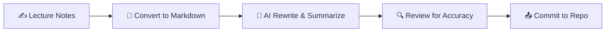

# 🧠 Web Programming Lecture Notes

**Lecture notes turned into clean Markdown, then rewritten and summarized with AI.**

---

## 🗺️ Overview

This repository holds my web programming lecture notes. Each set of notes is converted to Markdown and then refined with AI so the material is easier to review, revisit, and understand.

> 💡 **Tip:** Every file is plain Markdown, so it renders nicely on GitHub and works in any editor.

---

## 📚 Course Index

| # | 📄 File | 🧩 Topics Covered |
|:-:|:--------|:------------------|
| 1 | [`class1.md`](class1.md) | 🖥️ Transistors · 🖼️ Pixels to bits · 🔊 Audio sampling · 🎨 RGB color · 🌐 Internet history · 📦 Packet switching · ☕ Java history · 🔐 Persistent sign-in |

---

## 🔬 Lecture 1 at a Glance

<b>Click to expand the topic map</b>

| Area | Key Concepts |
|:-----|:-------------|
| 🖥️ Hardware | Transistors, binary switches (`1` / `0`) |
| 🖼️ Media | Pixels, 24-bit true color, ADC (sampling and quantization) |
| 🌐 Networking | ARPANET, packets, routers, OSPF / BGP, Dijkstra's algorithm |
| ☕ Software | Java, bytecode, JVM, "Write Once, Run Anywhere" |
| 🔐 Web | Session cookies, JWT, automatic token transmission |

---

## ⚙️ Workflow

| Step | Action | Tool |
|:----:|:-------|:-----|
| 1 | Take notes in class | ✍️ Pen, paper, or doc |
| 2 | Convert to Markdown | 📝 Editor |
| 3 | Rewrite and summarize | 🤖 AI assistant |
| 4 | Verify facts | ✅ Course sources |
| 5 | Save and version | 🐙 Git and GitHub |

---

## 🛠️ Tech Stack

---

> ⚠️ **Disclaimer:** This is personal study material. Verify details against the original course sources before relying on it for exams or production work.

### ⭐ If these notes help you, consider starring the repo!

